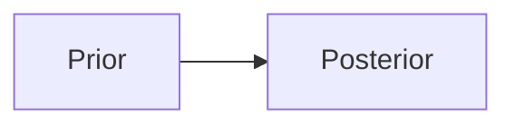

# Authoring guide

Conventions for writing articles in this repo. Claude follows this when generating an article; it's also the reference if you write or edit one by hand.

## 1. File and front matter

One article = one Markdown file in `_articles/`, named with a short kebab-case slug (`kelly-criterion.md`). The slug becomes the URL (`/articles/kelly-criterion/`) and the key that annotations are stored under, so **don't rename a file after you've annotated it**.

```yaml
---
title: "The Kelly Criterion"                 # required
subtitle: "One-line dek shown under the title"
topic: finance                               # required: a key in _data/topics.yml (science | philosophy | finance)
tags: [kelly-criterion, information-theory]  # 3–6 lowercase, kebab-case; reuse existing tags where possible
reading_time: 12                             # required: the intended minutes, as requested
date: 2026-10-09                             # required: YYYY-MM-DD
level: advanced                              # optional: intro | intermediate | advanced
summary: "2–3 sentences for the library card and the article header."
brief: "What was asked for (the request that produced this article)."
references:                                  # optional; rendered as a numbered list at the end
  - title: "Author (Year). Title. Venue."
    url: https://…                           # only if known to be correct
    note: "why it's worth reading"           # optional
---
```

To add a topic, add a key to `_data/topics.yml` and a colour token `--topic-<key>` (light and dark) plus a `.topic-<key>` rule in `assets/css/main.css`.

To hide an article without deleting it, add `published: false`.

## 2. Length calibration

`reading_time` is the intended time. Rough budget for dense technical prose:

| Target | Prose words | Plus |
|---:|---:|---|
| 5 min | 800–1,000 | 2–4 display equations, ≤ 1 figure |
| 10 min | 1,600–2,000 | 4–8 equations, 1–2 code blocks or figures |
| 20 min | 3,200–4,000 | sections with worked examples |
| 30+ min | 5,000+ | consider splitting into a series |

Run `python3 scripts/check_articles.py` to compare the estimate with the target.

## 3. Structure

- Open with a concrete hook or question (no "In this article…" preamble).
- `##` for sections, `###` for subsections. The TOC is built from these; 4–8 `##` sections suit 10–20 minutes.
- End with a `## Summary` of 3–5 bullets that restate the key results.
- Prefer precise statements with assumptions spelled out. Cite the sources of named results in `references`.

## 4. Math (KaTeX)

kramdown's math syntax is `$$…$$` for **both** inline and display math:

- Inline: `the rate $$G(f)$$ is concave` (stays inline when there is other text on the same line).
- Display: put `$$` on its own lines, with a blank line before and after.
- Single `$` is **not** math, so dollar amounts are safe.
- Avoid `|` inside math in Markdown tables (use `\mid` or `\lvert … \rvert`).
- Inside raw HTML blocks, use `\( … \)` and `\[ … \]`.

## 5. Code

Fenced blocks with a language: ```` ```python ````, ```` ```js ````, ```` ```text ```` for output. A copy button and language label are added automatically. Show real output (run the code) rather than made-up numbers.

## 6. Charts (Vega-Lite)

Embed a Vega-Lite v5 spec in a raw HTML block. Charts are themed automatically (fonts, colours, light/dark) and are full-width unless `width` is set.

```html
<div class="chart">
<script type="application/vnd.vegalite+json">
{
  "$schema": "https://vega.github.io/schema/vega-lite/v5.json",
  "height": 240,
  "data": {"values": [{"x": 1, "y": 2}, {"x": 2, "y": 3}]},
  "mark": "line",
  "encoding": {
    "x": {"field": "x", "type": "quantitative"},
    "y": {"field": "y", "type": "quantitative"}
  }
}
</script>
<p class="chart-caption">What the reader should notice.</p>
</div>
```

- The spec must be strict JSON (no comments or trailing commas).
- Use `"data": {"sequence": …}` with `calculate` transforms to plot functions without shipping data.
- Use `params` with `bind` for sliders and other interactive explorations.
- Don't set colours; the theme uses the article's topic colour. For several series, encode `color` by field.

## 7. Diagrams (Mermaid)

````markdown

````

## 8. Callouts

Add a class to a blockquote with a kramdown attribute list on the next line:

```markdown
> **Theorem (Breiman, 1961).** Statement…
{: .theorem}
```

Available: `.theorem`, `.definition`, `.proof` (adds ∎), `.example`, `.key` (main takeaway), `.note`, `.warning`, `.aside`.

## 9. Other

- Jekyll runs Liquid over articles, so `{{` and `{%` anywhere (including math and code) are interpreted as template tags. Add spaces (`{ {`) or wrap the passage in `…`.

- Footnotes: `text[^1]` … `[^1]: The note.`
- Tables: GFM pipe tables; right-align numbers with `---:`.
- Images: put them in `assets/img/<slug>/` and reference them with `{{ '/assets/img/<slug>/x.png' | relative_url }}`.
- Custom interactive widgets: a raw `<div id="…">` plus a `<script>` block is allowed. Keep it self-contained and theme-aware (read the CSS variables).
